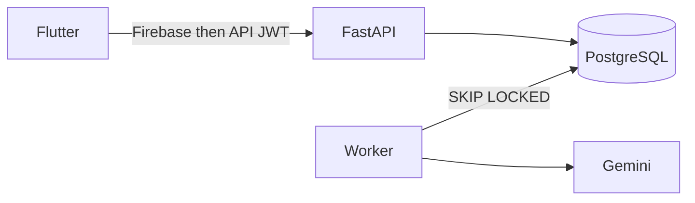
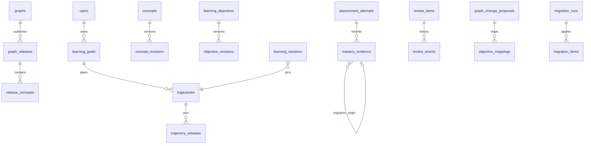

# Architecture

Flutter talks to FastAPI with an API JWT. Firebase is used only to prove identity at `POST /api/v1/auth/firebase`. Long model calls run in a Postgres-backed worker. PostgreSQL holds the versioned graph, evidence, and jobs.

Publication and learner migration do not call Gemini inside the database transaction. A shared publish moves `graphs.active_release_id` without waiting for every learner. Each goal keeps `goal_graphs.release_id` until that learner's migration succeeds.

## Modules

- `accounts` — Firebase exchange and users
- `knowledge_graph` — revisions, releases, tree, diff
- `graph_evolution` — proposals, overlays, migration
- `goals_trajectories` — goals, diagnostics, planner
- `learning_content` — cached activities
- `learning_sessions` — pinned sessions and attempts
- `retention` — FSRS review items
- `mastery` — evidence projection
- `platform` — jobs, audit, LLM, quota

## ERD

Objective ids are rows in `learning_objectives` and `activity_objectives`. A concept-level label is not enough to move mastery. Historical `assessment_attempts` and `mastery_evidence` are append-only. A transferred row points at the source evidence with `migration_origin_id`.

## Releases

`graph_releases` stores a checksum of the member revision ids. Shared versions are unique per graph where `overlay_id` is null. Overlay versions are unique per overlay. Rollback inserts a new release that points at older revisions.

Personal overlays never change the shared pointer. See `docs/ADR/001-immutable-releases.md` and `docs/ADR/002-evidence-migration.md`.
