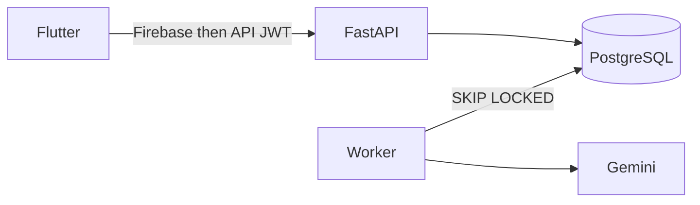

# Architecture

Flutter talks to FastAPI with an API JWT. Firebase is used only to prove identity at `POST /api/v1/auth/firebase`. Graph extension runs in a Postgres-backed worker so the model call stays off the request.

The worker locks the graph row only while merging nodes and edges. It does not call the model inside that transaction.

## Modules

- `accounts` — Firebase exchange and users
- `knowledge_graph` — the shared graph, nodes, edges, and the workspace payload
- `graph_extend` — extend requests and the merge
- `platform` — jobs, LLM client, quota, worker heartbeat

## Tables

- `users`
- `graphs` — one row, slug `knowledge`
- `concepts` — nodes, with `title`, `summary`, and `canonical_key`
- `edges` — `from_concept_id`, `to_concept_id`, `type`
- `extend_requests` — one row per request, from any user
- `generation_jobs`, `llm_usage`, `worker_heartbeats`
