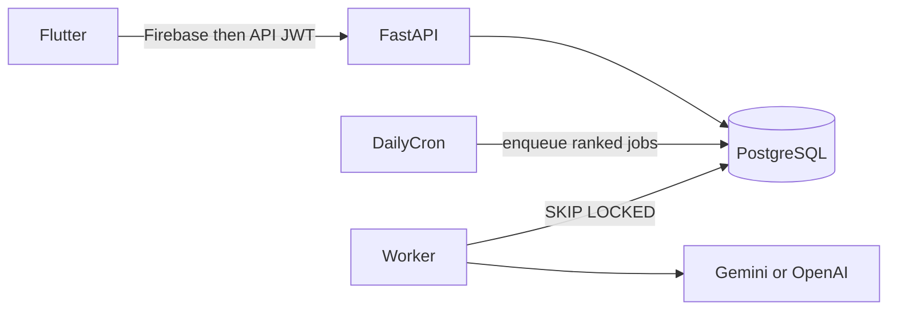
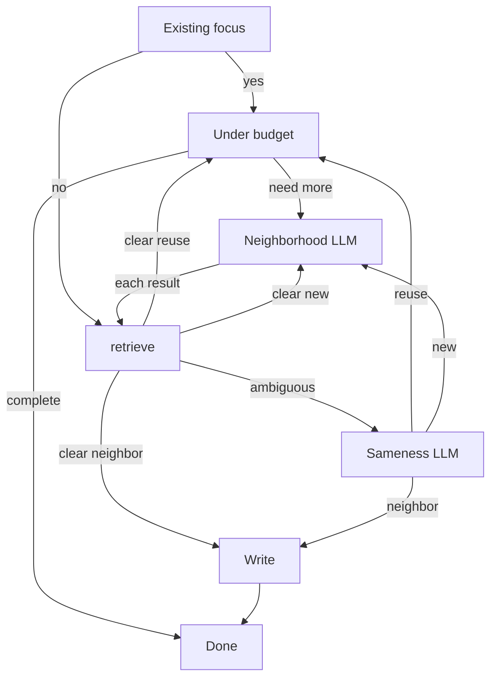

# Architecture

Flutter talks to FastAPI with an API JWT. Firebase is used only to prove identity at `POST /api/v1/auth/firebase`. Neighborhood and content generation run in a Postgres-backed worker so the model call stays off the request.

Provider choice comes from the user's `llm_provider` preference (Gemini or OpenAI/`gpt-5-mini`), falling back to `LLM_PROVIDER`. Topic images use the same preference for generation: Gemini Imagen or OpenAI Images (`generate_image` job). Uploaded topic images skip the worker and write full + thumb bytes on the knowledge node immediately. Atom images use the same providers (`generate_pack_image`, coalesced per `node_id`+`pack_index`) with the topic style prompt plus the atom learn bit; uploads write to `knowledge_pack_images`. Profile photos are uploaded to `users.photo_bytes` and served at `/me/photo`. Today each topic has one iconic image plus optional per-atom overrides on learn cards; a multi-visual gallery (testing variants) is anticipated but not implemented.

A separate Railway **cron** service (`python -m app.cron`, schedule `0 6 * * *`) ranks tiles from user–tile affinity and enqueues top neighbor/learn jobs into `generation_jobs`. It does not call the LLM; the always-on worker runs those jobs.

## Expand orchestrator

One `expand_neighborhood` job. Shared boxes: **retrieve** (deterministic), **Sameness LLM** (`sameness_v3`), **Neighborhood LLM** (`neighborhood_v6`), **Under budget**, **Write**, **Done**.

## Modules

- `accounts` — Firebase exchange and users
- `knowledge_graph` — shared LLM neighborhood graph (nodes, edges, requests)
- `content` — shared learning atoms (`pack_index` + learn / typed checks) and `expand_content` jobs
- `platform` — jobs, LLM client, quota, worker heartbeat
- `ranking` — user–tile affinity, neighbor/learn job scores, daily cron enqueue + `cron_runs`
- `reviews` — Leitner testing track
- `user_events` — topic events and profile affinity clustering

## Tables

- `users`
- `knowledge_nodes`, `knowledge_edges`, `knowledge_bits`, `knowledge_pack_images`
- `knowledge_requests`, `knowledge_request_nodes`
- `generation_jobs`, `generation_job_watchers`, `llm_usage`, `worker_heartbeats`
- `user_topic_events`, `user_pack_reviews`, `cron_runs`
